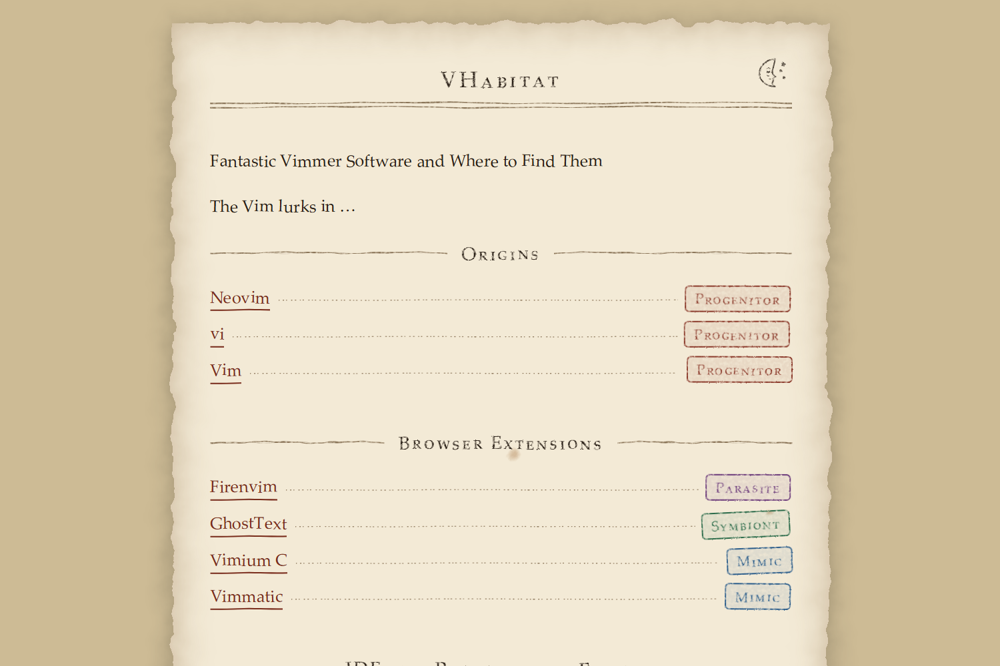

# Bestiary

A Hugo theme for field guides to imaginary creatures: an old natural-history book, with ragged, stained pages and entries stamped by kind.



The home page is an index of every entry, grouped by section in the order of the sections' `weight`, with the seals of each entry's choice fields beside it. Each section has a list page of the same form, and each entry has a page with its entry card. The site declares which fields an entry has; the theme names none of its own. A live example is [VHabitat](https://vhabitat.shortarrow.jp/).

## Requirements

Hugo 0.158.0 or later. The extended edition is not required.

## Installation

As a Hugo Module, add the import to your site's configuration:

```toml
[module]
  [[module.imports]]
    path = "github.com/ShortArrow/hugo-theme-bestiary"
```

As a theme directory, clone the repository into `themes/` and set `theme = "hugo-theme-bestiary"`.

## Entry fields

The site declares which fields an entry can have, in the order the entry card shows them:

```toml
[[params.bestiary.fields]]
  key = "kind"
  label = "Kind"
  type = "choice"
  [[params.bestiary.fields.choices]]
    value = "beast"
    label = "Beast"
    color = "#8b3a2b"

[[params.bestiary.fields]]
  key = "habitat"
  label = "Habitat"
  type = "text"
```

An entry sets its fields under `params` in front matter, so that a key such as `kind` does not collide with Hugo's own front matter. The card leaves out the fields an entry does not set.

```yaml
---
title: Inkwyrm
params:
  kind: beast
  habitat: Inkwells
---
```

| `type` | Front matter value | Card shows |
|---|---|---|
| `text` | a string | the string |
| `choice` | the `value` of one of the field's `choices` | the choice's `label`, coloured with its optional `color` |
| `links` | a list of `{label, url}` | the links |
| `date` | a date | the date in the site's locale |

The build fails when a field declares another `type`, and when a `choice` value is not one of the declared choices.

### Pages for each choice

A `choice` field with `pages = true` gets a page at `/<key>/` that lists its choices, and a page at `/<key>/<value>/` for each choice that lists the entries set to it. The seals on entry cards and in indexes link to these pages. The pages stay out of the home index and section lists. Without `pages = true`, no pages are made and seals are not links.

```toml
[[params.bestiary.fields]]
  key = "kind"
  label = "Kind"
  type = "choice"
  pages = true
```

## Weathering

By default the page is a worn leaf: headings and seals are printed in uneven ink, rules, index leaders and link underlines are drawn by hand, the leaf has ragged and browned edges, and the paper shows the wear of a book that has been looked after: creases from a fold smoothed out, now and then a corner turned back, a cup ring, a tide mark or a small scorch, faint foxing and thumb smudges, each placed and shaped differently on each page and the same on every build. Every letter on the leaf is set slightly askew by a small script, the same way on every visit. To print on a clean sheet instead:

```toml
[params.bestiary]
  weathering = false
```

## Day and night

Pages follow the reader's system scheme. A moon in the header turns them to night, and a sun turns them back to day; the new scheme billows out from the button like a puff of smoke (at once, for readers who ask for reduced motion), and the choice is kept in the reader's browser and restored before the page is painted. Without JavaScript the button stays hidden and the system scheme applies. To leave the scheme to the system alone:

```toml
[params.bestiary]
  schemeToggle = false
```

## Footer links

Entries in the site's `footer` menu are listed at the foot of every page, in menu order. Without a footer menu, pages have no footer.

```toml
[[menus.footer]]
  name = "Privacy policy"
  pageRef = "/privacy"
```

## Analytics

When the site sets `services.googleAnalytics.ID`, every page loads Hugo's Google Analytics template, which follows the site's `privacy.googleAnalytics` settings. Without an ID, pages load no analytics.

## Development

`tests/run.sh` builds `exampleSite` with the theme and fails if a page does not render. It needs `hugo` on `PATH`.

## License

MIT
